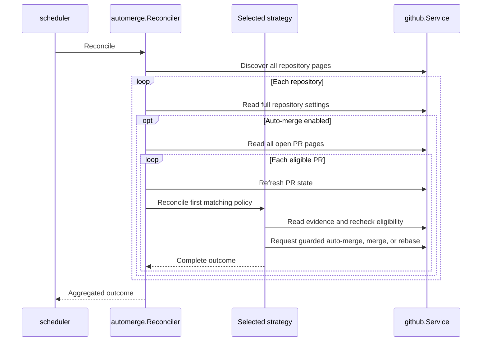
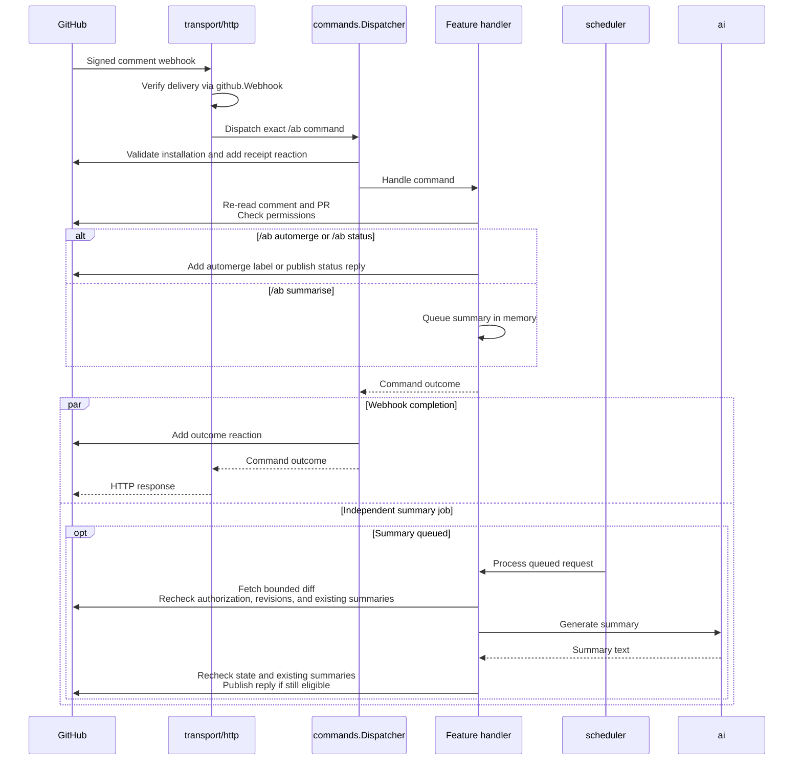

[](https://circleci.com/gh/alexfalkowski/abgleich)
[](https://codecov.io/gh/alexfalkowski/abgleich)
[](https://pkg.go.dev/github.com/alexfalkowski/abgleich)
[](https://masterminds.github.io/stability/active.html)

# 🔄 Abgleich

Abgleich is a background worker that enables auto-merge or merges ready
Dependabot and labeled pull requests, and keeps auto-merge branches current
across a GitHub account's opted-in repositories.

Maintainers can also request automation status and optional AI pull request
summaries through PR comments when webhooks are configured.
Optional branch cleanup removes merged leftovers and inactive branches.

## 🎯 Background

An open, non-draft pull request is stale when its branch is missing commits from
its base branch. Age does not affect eligibility. Only pull requests with
auto-merge enabled and both branches in the same discovered repository are rebased.
Public and private repositories accessible to the App installation are discovered on
each auto-merge run. Archived, disabled, and foreign repositories are excluded from
discovery. The auto-merge job skips repositories without **Allow auto-merge**
enabled. AI summaries are enabled through worker configuration and remain
available when auto-merge is disabled.

For Dependabot PRs, the worker also enables squash auto-merge while requirements
are pending, or requests a squash merge when GitHub reports the PR ready. It
identifies Dependabot by the PR author `dependabot[bot]`, independent of branch
names. This automatic Dependabot policy excludes draft, closed, and fork PRs.
Other authors can enable auto-merge themselves or opt in with a label.

### 🏷️ Labeled pull requests

Apply the exact label `automerge` to an open, non-draft PR to request squash
auto-merge. If GitHub reports the PR ready, the worker requests a guarded squash
merge immediately. The repository must allow auto-merge and squash merging.

This policy supports PRs from forks as well as branches in the repository. The
base must belong to the discovered repository. The worker never rebases fork
branches; their authors keep them current. Labeled branches in the same
repository can be rebased on a later sweep once auto-merge is enabled.

Label permissions in the target repository control who can opt a PR in. Forking
or opening a PR grants no labeling permission. Authorized bots and workflows can
also apply labels, so configure them accordingly. The label requests automation
for the PR; it is not an approval tied to a particular commit. Configure GitHub's
required reviews and stale-review rules when changes need human approval.

If GitHub disables auto-merge, including after an external contributor pushes,
the existing label cannot restore it. Remove and reapply `automerge` to renew the
request. Wait at least a second between removing and reapplying the label so
the event timestamps are unambiguous. The worker reads complete label and
disable-event history on each run, including after restart. Missing or invalid
history prevents automation; equal application and revocation timestamps defer it.

Removing the label prevents a new request; it does not cancel auto-merge already
enabled on GitHub. To stop that merge, disable auto-merge in GitHub as well.

### ⏸️ Hold a pull request

Apply the exact label `hold` to pause Abgleich on one PR. Maintainers apply and
remove it using their existing GitHub permissions. Matching is case-sensitive;
the label name is fixed and needs no worker configuration. Ensure the managed
repository baseline has provisioned `hold` before using it.

After observing the label, Abgleich skips auto-merge enablement, immediate merges,
rebases, and `/ab automerge` label requests for that PR, including Dependabot and
labeled fork PRs. Comment commands retain receipt and rejection reactions. Other
PRs continue normally. A current hold survives worker restarts because each run
reads GitHub state.

Removing the hold resumes normal policy. Dependabot can be enrolled again;
removing hold does not renew a labeled request revoked by auto-merge disablement
or removal of `automerge`.

The hold suppresses Abgleich requests only. It does not disable GitHub auto-merge
or undo an accepted request. Disable auto-merge in GitHub separately when it is
already enabled and must stop. The worker rechecks hold membership before acting,
but a label applied after the final read can still race a mutation.

### 🧹 Branch cleanup

When [enabled](#-cleanup-settings), cleanup removes leftover merged-PR branches
and inactive branches. Repositories must have **Allow auto-merge** enabled to opt
in; archived, disabled, and foreign repositories are excluded by discovery.

Cleanup runs immediately at startup, then on its independent schedule. It
preserves the default branch, protected branches, excluded names, and branches
used as the head or base of an open PR in the repository, including drafts.
A merged PR permits immediate cleanup only while its head SHA still matches the
branch. Newer commits are evaluated by the inactivity policy instead.

> [!CAUTION]
> Inactive cleanup can delete unmerged work, including branches without a PR or
> with a closed, unmerged PR. Inactivity uses the latest commit's committer date,
> not the last push time: recently pushing an old commit does not reset its age.
> Protect or exclude long-lived branches before enabling cleanup.

The worker finishes repository and branch discovery before deleting, rechecks
repository opt-in, branch protection, and open PRs, and uses GraphQL `updateRefs`
with `beforeOid` to reject a push racing deletion. It does not bypass rules or
retry mutation requests. Settings changes or a new PR after the final read can
still race deletion. Fork heads outside the discovered repository are untouched.
Failed branches do not block other branches, and cleanup failures do not affect
worker health. See [cleanup recovery](#-cleanup-recovery) for unintended deletions
and ambiguous responses.

### 💬 Comment requests

With GitHub App authentication and webhooks configured, post a new PR comment
containing exactly `/ab automerge`. Surrounding whitespace is allowed.
Mention-based commands are no longer supported; use `/ab automerge` to avoid
notifying GitHub users.
Commands are case-sensitive; extra text and unknown commands are ignored without reactions.
The worker checks the author's current write or admin permissions, re-reads the
comment and PR, and adds `automerge`. The App reacts on the original command:

| Reaction | Meaning |
| --- | --- |
| 👀 | The signed command was received and processing started. |
| 👍 | The request was accepted: the label was added or automation was already enabled or labeled. |
| 😕 | The request was ineligible, rejected, or failed. |

Acceptance confirms command processing; the PR's status shows when merging finishes.
The label remains the durable request for automation;
the next scheduled sweep applies the existing merge policy. Fork PRs are supported.
Edited comments and bot authors do not authorize requests.

An existing label or enabled auto-merge needs no label write. The App still checks
the current comment and the author's permission before acknowledging acceptance.
A delivery whose original comment is at or before a label removal or auto-merge disablement
cannot add the label. Missing history prevents action. After a revocation, remove
any remaining label and post a new command with a later timestamp to renew the
request. These checks survive restarts without local storage. GitHub label writes
do not support an expected-state guard: a simultaneous manual change can still
race the final write. This is not an exactly-once delivery guarantee.

Reactions are best effort and do not control automation. Receipt feedback gets at
most one second and a quarter of the remaining delivery budget, so slow feedback
leaves time for the label operation. Final acceptance or rejection feedback uses
the remaining delivery budget. An outage or exhausted deadline can leave feedback
incomplete; reaction failures are logged.
Reactions remain on the comment, and GitHub reuses an existing reaction on
redelivery. A later attempt can therefore leave both rejection and acceptance
reactions; consult the label and current PR state for the outcome.

### 🔎 Explain a pull request's automation status

With the same App and webhook setup, post a new comment containing exactly
`/ab status`. The requester needs current write or admin access. Surrounding
whitespace is allowed; arguments, edited comments, and bot authors are ignored.
The App replies with its observed policy decision, reason, and next step,
including the head commit, UTC assessment time, GitHub auto-merge state, and a
link to the request. Receipt and outcome reactions use the same delivery budget;
acceptance means the status reply was confirmed published.

Status explains repository opt-out, drafts, closed PRs, `hold`, squash-merge
settings, label authorization, and the applicable Dependabot, label, or rebase
strategy. For example, a label that predates auto-merge disablement reports
**Waiting for renewed authorization** and explains how to remove and reapply it.
Forks can use labeled merging, but their authors must keep their branches current.

The reply describes what the worker would attempt under the observed state.
It never labels, enables auto-merge, merges, rebases, approves, or bypasses rules.
GitHub still enforces merge requirements. Coarse mergeability does not identify
individual failing checks or missing reviews; consult GitHub's merge box for
those details. Unavailable history or comparison evidence is reported explicitly.

GitHub reads are separate observations, not an atomic snapshot. A detected
change to the revision or policy state rejects the request without a reply
(HTTP 409); post a new `/ab status` request to retry. State can still change after
the final check. Publication is best effort within the configured command
deadline and is never retried automatically. A failed or timed-out response can
already have published a reply, and webhook redelivery can produce another
comment with the same request link. No exactly-once publication is promised.

### 📝 AI pull request summaries

With [summaries and webhooks configured](#-summary-settings), post a new PR
comment containing exactly `/ab summarise`; surrounding whitespace is allowed.
The PR must be open and non-draft, and the unedited human comment's author must
currently have write or admin access. Maintainers can request summaries in
repositories accessible to the App installation without adding a repository topic.

The independent summary job processes at most four queued requests serially.
Inference uses at most one minute and half the remaining job budget. Status and
automerge commands remain usable while inference runs; a full queue returns
HTTP 503.

The App reacts 👀 on receipt and 👍 when the request is queued or a summary already
exists. Acceptance precedes model completion. The later App reply identifies the
analyzed head SHA and original request. **An existing App summary prevents another
model call or summary comment, including after restart or a head change.**
Pending work stays in memory. See [summary recovery](#-summary-recovery) for
restarts, fresh summaries, and retries after failures.

> [!IMPORTANT]
> An authorized `/ab summarise` comment authorizes sending selected PR metadata
> and changed-file patches to OpenAI, including private repositories and fork
> contributions. Approve the provider's data handling and billing before enabling
> summaries. Summary requests are independent of auto-merge settings and labels.
> Summaries are advisory and never label, approve, merge, rebase, or execute code.

Context includes at most 20 changed files, 8 KiB per patch and 16 KiB of patches in
total. PR titles, descriptions, and filenames are passed through without
truncation. Missing or oversized patches and omitted files are disclosed to the
model. Complete files and repository trees are not retrieved; code and tests are
not executed. The model returns plain text with a 2,048-token output budget.
The prompt asks for fewer than 150 words: a brief behaviour summary and up to
three changed-file pointers explaining where to start reading. Specific context
omissions get a short closing note. This word target is prompted, rather than
enforced by truncation. Per-line citations are not generated or validated.
Inspect the diff before relying on an explanation. Source text is untrusted
input; the model receives no tools or GitHub credentials.

The command, permission, PR eligibility, and both branch revisions are checked
before source submission and publication. Revocation prevents the next observed
submission or reply. Revision changes discard the explanation and ask for a new
request. Already transmitted source cannot be recalled, and a change after the
final read can still race publication. Provider refusals, failures, incomplete or
empty responses, and timeouts produce failure feedback when still authorized;
health and auto-merge remain independent.

The adapter uses the official
[OpenAI Go SDK](https://developers.openai.com/api/docs/libraries), explicit
credentials, `store: false`, and no automatic inference retries. Evaluate the
selected model on approved PRs before widening opt-in; bounded diff context
cannot establish whole-PR accuracy.

## 🚀 Quickstart

Run these steps from the repository root.

### ✅ Prerequisites

- Go matching [go.mod](go.mod).
- Git with GitHub SSH access for the `bin/` submodule.
- Ruby with Bundler for dependency setup and the Cucumber harness.
- Make, plus `curl` for the readiness check below.

### 🏗️ Bootstrap and build

Initialize the shared tooling, install dependencies, and build the worker:

```sh
git submodule sync
git submodule update --init
make dep
make build
```

### ▶️ Configure and start

Save the [base configuration](#-base-configuration) as `config.yaml` and fill in
your GitHub owner, App IDs, and private-key source. Follow
[GitHub App setup](#-github-app-setup) to register and install the App.
The [Configuration](#-configuration) section also contains the optional blocks
for comment webhooks, branch cleanup, and AI summaries.

Start the worker:

```sh
./abgleich server -config file:config.yaml
```

The worker begins checking the account's repositories immediately. Leave it
running, and use another terminal to verify readiness:

```sh
curl --fail --silent --show-error http://localhost:11000/abgleich/readyz
```

An HTTP 200 response with body `SERVING` confirms process readiness. Check the
worker's structured logs for GitHub check outcomes; readiness is independent of
whether a branch check succeeds.

## 🚀 Server

The auto-merge job runs immediately on startup and follows its
[configured schedule](#-auto-merge-schedule). It discovers all owned repositories
before processing them serially.
For each repository, it lists open pull requests through go-github and processes
them oldest first by creation time. It compares each eligible branch with its base
and asks GitHub to rebase stale branches using the GraphQL
[`updatePullRequestBranch`](https://docs.github.com/en/graphql/reference/pulls#updatepullrequestbranch)
mutation with `updateMethod: REBASE`. This is the server-side operation used by
GitHub's update-with-rebase UI and CLI. GitHub performs the branch update.

Before listing PRs, the worker reads the full repository settings; GitHub's
repository list omits merge settings. Dependabot and labeled automation use GraphQL
[`enablePullRequestAutoMerge`](https://docs.github.com/en/graphql/reference/pulls#enablepullrequestautomerge)
with `mergeMethod: SQUASH` and `expectedHeadOid`, or the REST merge API with
`merge_method: squash` and the expected head SHA. Immediate merges require `mergeable: true` and
`mergeable_state: clean`; unknown or failing check states never trigger an
immediate merge. GitHub still enforces checks, reviews, and repository rules.
The worker does not approve reviews or request rule bypasses.

Each sweep attempts at most one mutation per PR. After enabling auto-merge,
a later sweep can rebase a stale branch. If squash merging is disabled, the
merge action fails with an operator-visible error instead of choosing
another merge method. Other authors' auto-merge PRs retain their selected method.

Pull requests are rechecked immediately before each mutation. Rebases and
auto-merge enablement include `expectedHeadOid`, and immediate merges include `sha`, so concurrent branch changes
reject those requests and are discovered on the next run. Conflicts reported by GitHub fail the branch and
require an author to repair it. One failed branch does not prevent other
eligible branches or repositories from being processed. After a timeout, the
next scheduled sweep starts with fresh repository discovery.

Discovery validates that the App installation belongs to `github.owner`.
All repository pages must succeed before processing begins. Pull request pagination
also finishes before any branches in that repository are updated.

The process needs network access to the GitHub REST and GraphQL APIs. It does
not clone repositories, execute Git, or need a writable checkout directory.

### 🚦 API usage

The shared go-github client processes repositories and pull requests serially.
The configured auto-merge interval limits polling volume; there is no additional
rate-limit library or configuration. If GitHub reports throttling, the current
sweep stops instead of continuing through other repositories. go-github retains
its built-in rate-limit checks, and a later scheduled run reads current state
again. Polling and comment commands share the installation's API budget.

### 💬 Webhook delivery

The comment handler requires SHA-256 signatures and enforces the configured
request body limit. It acknowledges ignored and completed deliveries with
HTTP 204, rejects invalid signatures with 401 and unauthorized commands with 403,
and returns non-success for API failures, conflicts, or processing timeouts.

Automerge and status processing stays inside the request. Summary commands queue
in-memory work for their own scheduled job. Each process accepts one command at a
time, with concurrent webhook commands receiving 503; inference does not hold that
slot. Installation requests share a cancellable request slot so a webhook deadline
also bounds waiting for another request or token renewal. Polling continues when
webhook delivery is unavailable. App API failures can prevent both polling and
comment operations; they do not affect process health. See
[webhook recovery](#-webhook-recovery) for failed or ambiguous deliveries.

## ⚙️ Configuration

All worker settings, configuration examples, defaults, and credential setup live
in this section. Start with the base configuration, then merge any optional
blocks into the same file. Feature sections describe behaviour and safeguards;
[Operations](#-operations) covers monitoring and recovery.

### 📄 Base configuration

Save this as `config.yaml`. Replace `github.owner`, the App and installation IDs,
and the private-key source with your own values. The `github` and `health` blocks
are required. `health.duration` controls sampling frequency and `health.timeout`
bounds the connectivity check independently of job deadlines; both must be
positive durations and have no defaults. The example also includes shared
go-service settings for identifiers, logging, metrics, and the HTTP listener.

```yaml
environment: production
github:
  owner: alexfalkowski
  app:
    id: 5427450
    installation_id: 174152088
    private_key: file:/etc/secrets/abgleich/github-app-private-key.pem
health:
  duration: 1s
  timeout: 1s
id:
  kind: uuid
telemetry:
  logger:
    kind: json
    level: info
  metrics:
    kind: prometheus
transport:
  http:
    address: tcp://:11000
    timeout: 9s
    max_receive_size: 1048576B
```

This configuration runs merge automation without a webhook endpoint, branch
cleanup, or AI summaries. See the
[defaults and validation table](#-defaults-and-validation) for optional settings.

### 🤖 GitHub App setup

The worker and comment handler share one App installation. `github.owner` must
match the installation's account. Register the App with **Contents: read and
write**, **Pull requests: read and write**, and **Issues: read and write**.
Metadata read access is automatic. These permissions cover server-side rebases,
squash merges, branch deletion, diff reads, comments, label writes, and reactions.
Issues write access is required for comment reactions. When upgrading an existing
App, update its permissions and approve the installation's permission change.

Install the App on all owned repositories to include new repositories
automatically, or select repositories explicitly. Enable **Allow auto-merge** on
each repository to opt in to merge automation and cleanup, and **Allow squash
merging** for Dependabot and labeled automation. Required reviews and checks
still apply; give the App no ruleset bypass.

The worker validates the installation's App ID, owner, and suspension state once
per sweep and once per comment command, before repository access. It discovers
only repositories granted to that installation, including private repositories.
A personal access token is not used. `ghinstallation` signs App requests and
caches and renews the installation access token. REST and GraphQL use the same
installation credentials; App clients reject redirects to another API origin.

When migrating from token authentication, replace `github.token` in runtime
configuration with the `github.app` block in the base example. The deployed secret
can retain its old token entry during rollout; remove that unused entry after a
successful rollout.

### 💬 Comment webhooks

Add this block to the existing `github` mapping to enable comment commands.
Omit `github.webhook` to run without a webhook endpoint.

```yaml
github:
  webhook:
    secret: file:/etc/secrets/abgleich/github-webhook-secret
    timeout: 8s
```

Configure the App's **Issue comment** subscription, a random webhook secret
matching `github.webhook.secret`, and an HTTPS webhook URL ending in
`/webhooks/github`. The proposed deployment URL is
`https://abgleich.lean-thoughts.com/webhooks/github`; DNS and ingress must be
provisioned before activation.

Keep the HTTP request, webhook, job, and health timeouts independent. The server
HTTP timeout must accommodate the webhook budget: this example's `8s` budget
leaves room for permission checks, labeling, and feedback within the base
configuration's `9s` HTTP timeout and GitHub's ten-second delivery deadline.
The shared `transport.http.max_receive_size` limit applies to webhook deliveries.
See [webhook delivery](#-webhook-delivery) for responses and concurrency behaviour.

### 🧹 Cleanup settings

Add this block to enable branch cleanup; omit it and restart to disable its job.
Read the [branch cleanup safeguards](#-branch-cleanup) before enabling deletion.

```yaml
cleanup:
  inactive_after: 720h
  interval: 24h
  timeout: 5m
  exclude:
    - develop
```

`exclude` contains exact, case-sensitive branch names to preserve in addition to
protected, default, and open-PR branches. `inactive_after` is the latest-commit age
required for inactive cleanup.

### 📝 Summary settings

Add the `ai` and `summarise` blocks below and configure
[comment webhooks](#-comment-webhooks) to enable `/ab summarise`. Set the key source
and choose the model explicitly. Read the
[summary source-sharing notice](#-ai-pull-request-summaries) before enabling it.

```yaml
ai:
  provider: openai
  openai:
    api_key: file:/etc/secrets/abgleich/openai-api-key
summarise:
  model: gpt-6.1-sol
  interval: 30s
  timeout: 2m
```

Omit both blocks to run without AI. Omitting `summarise` disables the command's
work and its scheduled job even if provider configuration remains. Use a trusted
`ai.openai.url` override because that endpoint receives the key and source.
Existing GitHub App permissions cover diff reads and comment publication.

### 🔌 HTTP transport

GitHub transport settings live under `github.client`; AI transport settings live
under `ai.client`. Each has its own connection pool, request timeout, TLS, and
circuit-breaking settings. TLS credentials and trusted roots are resolved at
startup; invalid sources prevent startup. Circuit breaking is disabled unless
configured. Idle connections close during shutdown after scheduled work stops.

GitHub retries are disabled unless configured. To enable safe-method retries,
merge this block into `github`:

```yaml
github:
  client:
    retry:
      attempts: 2
      backoff: 100ms
```

Rebase, auto-merge, merge, and deletion mutations are never retried by the HTTP
transport; a later scheduled run reads current state before deciding whether
another action is needed. AI requests never retry, even when `ai.client.retry`
is configured. Its HTTP timeout cannot extend the independent inference limit
or the remaining summary job budget.

### 🗓️ Auto-merge schedule

The optional `scheduler` block controls owner-wide auto-merge sweeps. Cleanup and
summaries have independent schedules under their own configuration blocks.

```yaml
scheduler:
  interval: 15m
  timeout: 5m
```

### ⏱️ Defaults and validation

| Setting | Default | Purpose |
| --- | --- | --- |
| `scheduler.interval` | `15m` | Time between owner-wide auto-merge sweeps. |
| `scheduler.timeout` | `5m` | Deadline for a complete auto-merge sweep. |
| `cleanup.inactive_after` | `720h` (30 days) | Latest-commit age required for inactive cleanup. |
| `cleanup.interval` | `24h` | Time between cleanup runs. |
| `cleanup.timeout` | `5m` | Deadline for a complete cleanup run. |
| `cleanup.exclude` | `[]` | Exact, case-sensitive branch names to preserve. |
| `summarise.model` | None | Required model when `summarise` is configured. |
| `summarise.interval` | `30s` | Time between summary queue processing runs. |
| `summarise.timeout` | `2m` | Deadline for a complete summary job run. |
| `github.client.timeout` | `1m` | Deadline for an individual GitHub HTTP request. |
| `github.url` | `https://api.github.com/` | REST API base URL, shared with GraphQL. |
| `github.webhook.timeout` | `5s` | Complete synchronous delivery budget; must be positive and below `10s`. |
| `ai.client.timeout` | `1m` | Deadline for an AI HTTP request, bounded by the inference and job budgets. |
| `ai.openai.url` | `https://api.openai.com/v1/` | Trusted provider API base URL. |
| `transport.http.max_receive_size` | `4MB` | Incoming request body limit for all HTTP routes. |

Omitted or zero auto-merge, cleanup, and summary job durations, inactivity
thresholds, webhook budgets, and GitHub and AI client timeouts use the defaults
above. Negative schedule durations, inactivity thresholds, and HTTP client
timeouts are invalid. Excluded branch names must be nonempty.

### 🔐 Credentials

App private keys, webhook secrets, and AI keys use go-service sources such as
`file:/etc/secrets/abgleich/github-app-private-key.pem` or `env:OPENAI_API_KEY`.
Credentials and TLS sources are resolved once at startup. Keep credential files
in a `secrets/` directory.

> [!IMPORTANT]
> Missing or empty configured credential sources and invalid RSA PEM or TLS
> sources prevent startup. Restart the worker after replacing these sources.
> Installation access tokens renew automatically. Authentication failures during
> requests do not make worker health fail.

## 🛠️ Operations

### 🩺 Health

The service exposes HTTP observability endpoints:

| Endpoint | Behavior |
| --- | --- |
| `/abgleich/healthz` | Shared external connectivity check. |
| `/abgleich/readyz` | Process readiness, independent of scheduled job outcomes. |
| `/abgleich/livez` | Process liveness, independent of GitHub failures. |
| `/abgleich/metrics` | Prometheus metrics when that exporter is configured. |

Job failures, conflicts, and timeouts do not affect these health checks. Infraops
probes the private readiness and liveness endpoints directly, including for
workers without a Service or Ingress.

### 📊 Telemetry

Each completed run produces one log entry with `job`, `duration`, `interval`, and
`overrun`. Jobs identify themselves as `automerge`, `cleanup`, or `summarise`.

| Outcome | Log level | Details |
| --- | --- | --- |
| Success | `info` | The check completed within its interval. |
| Successful overrun | `warn` | The check succeeded but exceeded its interval. |
| Failure | `error` | Includes the error, even when the check also overran. |

Accepted rebase requests, enabled auto-merges, and confirmed merges identify the
repository, pull request, and branch. Their messages are `requested pull request rebase`,
`enabled pull request auto-merge`, and `merged pull request`, respectively. Failures
include repository names and pull request numbers where available. GraphQL errors
are failures even when the HTTP response is 200. A failed branch contributes to
the run's failure outcome while other eligible branches continue to be processed.

- **Timeouts:** each job cancels its active work at its configured deadline.
- **Overruns:** work that exceeds its interval sets `overrun` to `true` when it
  finishes, preserving the handler's success or failure result.
- **Overlap:** each tick attempts to start work. Attempts while the previous run
  is active are ignored; missed attempts are not queued.

Scheduled job monitoring uses structured logs. Configure collection and alerts
for repeated failures, exceeded intervals, and missing completed runs in your log
backend. Repeated rate-limit failures may require increasing the
[auto-merge interval](#-auto-merge-schedule). The scheduler does not publish custom
job metrics. Standard go-service HTTP and runtime telemetry remains available
through its configured exporters.

Successful branch deletions log `deleted branch` with repository, branch, and
SHA. Retain accepted-action logs for recovery; an ambiguous response can leave a
successful remote action without a corresponding acceptance log.

Monitor `job: summarise` outcomes and `ai generation` logs for task, model,
duration, and token usage. Generation logs use info for success and error for
failure; token usage is included on success. Source, responses, and credentials
are not logged.

### 📦 Deployment

- **Instances:** run as a long-lived service with one active instance. Scheduling
  limits apply within a process; the expected head OID guards updates from other instances and CI.
- **Restarts:** use liveness for restart decisions so a GitHub outage does not cause restart loops.
- **Shutdown:** active work is cancelled, and the worker waits for it to stop.

The standard service container image is sufficient.

### 🧯 Recovery

#### 🔄 Auto-merge recovery

No local checkpoint or database is needed. Each auto-merge run reconciles current
GitHub state. After a crash, timeout, or ambiguous mutation response, a fresh run
determines whether the remote branch still needs updating. GitHub can complete
an accepted update after the caller stops waiting; retries always compare current
remote state before requesting another rebase.

#### 💬 Webhook recovery

GitHub does not automatically redeliver failed webhooks. Inspect delivery results
in the App settings and redeliver failures after recovery. Ambiguous label
responses are not retried automatically; redelivery re-reads current state.

#### 📝 Summary recovery

Pending summary requests are held in memory and lost on restart; post
`/ab summarise` again to reissue them. Published App summaries remain on GitHub
and prevent another generation, including after restart or new commits. To
request a fresh summary, delete the existing App summary and post `/ab summarise`
again. Failure replies do not prevent retrying.

The worker checks current App comments before generation and publication, so an
existing summary also prevents duplication after an ambiguous GitHub response.
Exactly-once inference is not guaranteed if generation finishes without a
published comment.

#### 🧹 Cleanup recovery

If deletion was unintended, recreate the branch from the SHA in the deletion log
while GitHub retains the commit. A merged PR may also offer **Restore branch**.
A lost response can mean deletion succeeded without an acceptance log; inspect
GitHub before acting.

## 🧩 Design

| Package | Responsibility |
| --- | --- |
| [`automerge`](internal/automerge/doc.go) | Merge reconciliation and the automerge command. |
| [`automerge/internal/strategy`](internal/automerge/internal/strategy/doc.go) | Dependabot, label, and rebase policies. |
| [`cleanup`](internal/cleanup/doc.go) | Optional merged and inactive branch cleanup. |
| [`status`](internal/status/doc.go) | Read-only automation assessments and replies. |
| [`summarise`](internal/summarise/doc.go) | Authorized queued summaries and bounded diff context. |
| [`ai`](internal/ai/doc.go) | Provider credentials and text generation. |
| [`commands`](internal/commands/doc.go) | Dispatch, installation validation, queues, and reactions. |
| [`github`](internal/github/doc.go) | Discovery, identity checks, API access, and response validation. |
| [`scheduler`](internal/scheduler/doc.go) | Independent jobs, deadlines, overlap protection, and outcome logs. |
| [`transport/http`](internal/transport/http/doc.go) | Webhook verification, deadlines, and HTTP responses. |
| [`transport/http/client`](internal/transport/http/client/doc.go) | Separate outbound clients and connection-pool lifecycle. |
| [`cmd`](internal/cmd/module.go) | Module composition. |

### 🔄 Auto-merge sweep

Each run starts from fresh remote state. The diagram shows an eligible action;
policy checks can also produce a no-op or error.



- Strategies run in **Dependabot → label → rebase** order. The first match owns
  the PR for that sweep, including no-op and error outcomes; each PR gets at most
  one mutation attempt. See [Server](#-server) for guards and failure handling.
- `github` owns complete API snapshots and history; `automerge` applies policy
  to those facts. `status` reuses read-only assessments from `automerge`.

### 💬 Comment commands

The diagram shows accepted commands and independent summary processing.
All GitHub API calls pass through `github.Service`.



- Feature packages own command authorization and actions. `commands` and
  `scheduler` stay independent of features. Summary inference runs outside the
  webhook command slot; see [AI summaries](#-ai-pull-request-summaries) for safeguards.
- SDK imports stay inside `github` and `ai`. Both use `transport/http/client`
  for separate settings and connection pools; see [HTTP transport](#-http-transport).

### 🗓️ Job registration

- Feature modules register named jobs through `Scheduler.Register` and commands
  through `commands.Dispatcher.Register` before startup. Duplicate names prevent
  startup. Jobs are `automerge` and, when configured, `cleanup` and `summarise`.
- Each job runs immediately, then independently with its own interval, timeout,
  and overlap protection. Missed starts are skipped. See
  [Telemetry](#-telemetry) for outcome logging and monitoring.
- Shutdown cancels all jobs before waiting for handlers, then closes outbound
  connection pools. Handlers must observe cancellation and return their complete
  outcome. Health checks remain independent of job outcomes.

## 🛠️ Development

If you would like to contribute, here is how you can get started.

### 🗂️ Structure

The project follows the structure in [golang-standards/project-layout](https://github.com/golang-standards/project-layout).

### ✍️ Style

This project favours the [Uber Go Style Guide](https://github.com/uber-go/guide/blob/master/style.md)

### 🏁 Setup

After completing the quickstart's bootstrap steps, run the auto-merge features:

```sh
make features feature=features/automerge
```

Use `make help` to discover the other development commands.

Run a CI feature group locally with `make features-merges`,
`make features-commands`, or `make features-worker`. These select `@merges`,
`@commands`, and all remaining features, respectively. New features belong to
the worker group unless tagged for one of the other groups. Run groups one at
a time locally because the harness shares ports and configuration files.

Nonnative starts the worker and independent fake GitHub REST/GraphQL and OpenAI
Responses APIs on one local HTTP listener:

- [Rebasing](test/features/automerge/rebase.feature) covers eligibility,
  pagination, conflicts, and concurrent changes.
- [Dependabot](test/features/automerge/dependabot.feature) covers repository opt-in,
  enabling auto-merge, guarded squash merges, exclusions, and failure recovery.
- [Labels](test/features/automerge/label.feature) covers labeled fork and repository
  PRs, authorization renewal, complete history, and concurrent changes.
- [Repositories](test/features/automerge/repositories.feature) covers owner-wide
  discovery, private repositories, failure isolation, throttling, and timeout recovery.
- [Recovery](test/features/automerge/recovery.feature) covers GitHub failures,
  retries, and ambiguous mutation responses.
- [Scheduling](test/features/automerge/schedule.feature) covers timeouts,
  overlap prevention, and restart recovery.
- [Credentials](test/features/config/config.feature) covers startup token
  validation and replacement. Run it with `make features feature=features/config/config.feature`.

Failure scenarios also verify that process probes remain healthy. Tests use an
accelerated schedule and disposable credentials; they do not modify GitHub.
The harness reuses committed test credentials in `test/secrets/`, including RSA
keys created for the local fake GitHub API. Failure scenarios select
separate invalid or missing fixture paths; tests leave these files unchanged.
Reports contain logs and test results.
See [CI](.circleci/config.yml) for the build and release workflow.

### 📝 Changes

Release history is available in [GitHub releases](https://github.com/alexfalkowski/abgleich/releases).
