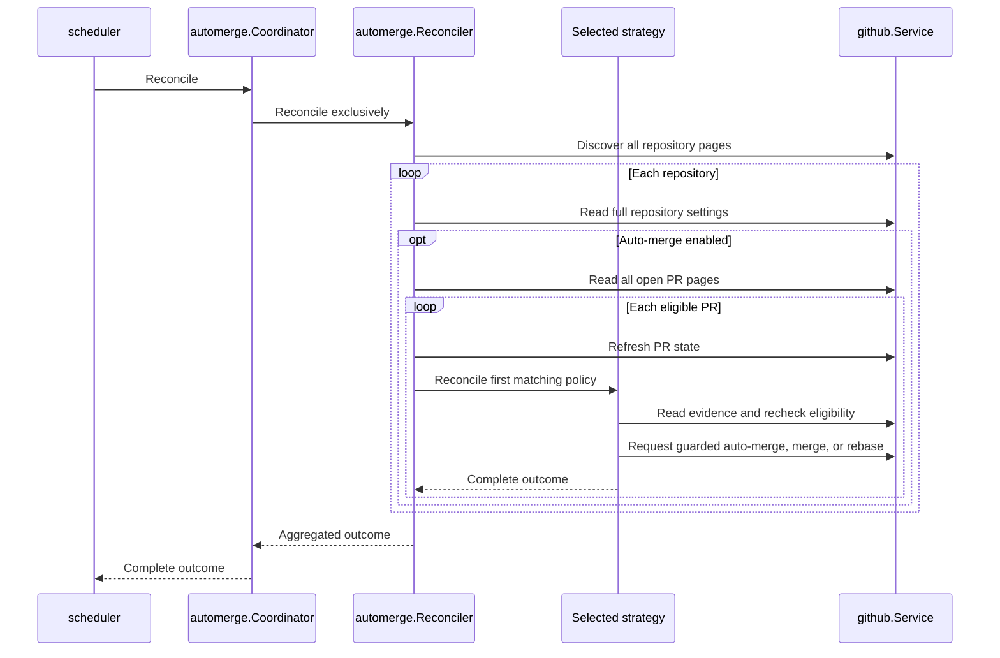

[](https://circleci.com/gh/alexfalkowski/abgleich)
[](https://codecov.io/gh/alexfalkowski/abgleich)
[](https://pkg.go.dev/github.com/alexfalkowski/abgleich)
[](https://masterminds.github.io/stability/active.html)

# 🔄 Abgleich

Abgleich enables auto-merge or merges ready Dependabot and labeled pull requests,
and rebases stale auto-merge branches across a GitHub account's opted-in repositories.
Optional features provide branch cleanup, automation status, and AI PR summaries.
GitHub performs all repository mutations; the worker never clones repositories or
executes Git.

## 🎯 Background

Each sweep discovers public and private repositories accessible to the App
installation, excluding archived, disabled, and foreign repositories. Merge
automation requires **Allow auto-merge**. Only open, non-draft PRs are eligible.

For PRs authored by `dependabot[bot]` with both branches in the discovered
repository, Abgleich by default enables squash auto-merge while requirements are
pending or requests a squash merge when ready. Other authors can enable auto-merge
themselves or use the label below.

Configure [Dependabot repository exclusions](#-dependabot-settings) to require
explicit opt-in in selected repositories. Excluded repositories still accept
the `automerge` label and `/ab automerge`, including their normal consent checks.
Exclusion does not cancel existing GitHub auto-merge; those branches remain
eligible for rebasing. Disable auto-merge in GitHub separately to stop an existing
request.

Auto-merge PRs are rebased when their branch lacks base-branch commits, regardless
of age, and only when both branches belong to the discovered repository. AI
summaries are enabled separately through [configuration](#-summary-settings).

### ⚡ Event-triggered checks

With [webhooks configured](#-comment-webhooks), GitHub notifications also prompt
checks of the affected repository. PR changes and branch pushes trigger a check;
terminal commit statuses and completed check runs prompt another assessment after
CI advances. Auto-merge enablement and ready merges use the existing policies.
GitHub [completes enabled auto-merge](https://docs.github.com/en/pull-requests/how-tos/merge-and-close-pull-requests/automatically-merging-a-pull-request)
when required checks and reviews pass.

Event-driven rebasing requires a [configured final CI signal](#-event-driven-rebase-settings)
on the current head and no reported active checks or pending commit statuses.
This lets CI reach its own sync-and-push stage first. An individual job finishing
does not establish workflow completion. A missing signal, unreadable or incomplete
observations, and new heads without completed CI defer event rebasing. A failed
final signal still establishes completion; GitHub enforces merge requirements.

A later base update can prompt repair once the head's CI has finished. If CI
already synchronized the branch, the fresh comparison needs no rebase. Startup
and scheduled recovery retain their existing rebase policy and do not require
the final CI signal, including when a failed workflow never reaches its sync job.

Notifications are hints: every check completes fresh installation discovery,
reads current repository settings, and finishes its PR pagination before applying
the same policies as a scheduled sweep. Only the affected repository's PRs are
checked. Bot events are supported; label consent and `hold` still apply.
CI can restart after the final observation; head guards reject concurrent pushes,
but the worker does not lock CI or promise to eliminate competing runs.

One automerge coordinator serializes event checks and scheduled sweeps per
process. Repeated notifications for a queued repository combine into one check.
Events received during its check request one later pass. Pending notifications
are held in memory without a fixed repository limit. An event may wait behind a
running sweep.

Startup and [scheduled sweeps](#-auto-merge-schedule) still reconcile all opted-in
repositories, recovering missed events, failures, and pending work lost on restart.
Cleanup and summary jobs retain their independent schedules.

### 🏷️ Labeled pull requests

Apply the exact `automerge` label to request squash auto-merge or an immediate
guarded squash merge when ready. The repository must allow both auto-merge and
squash merging. Fork PRs are supported when their base belongs to the discovered
repository; fork authors must keep their branches current. Same-repository
branches can be rebased on a later sweep.

Target-repository label permissions control opt-in, including labels from bots
and workflows. The label authorizes the PR across commits; configure required
reviews and stale-review rules for human approval.

After GitHub disables auto-merge, remove and reapply `automerge` to renew consent,
waiting at least a second between events. Complete label and disable history is
checked on every automation check, including after restart. Missing or invalid
history blocks automation; equal application and revocation timestamps defer it. Removing the
label prevents new requests but does not cancel existing GitHub auto-merge;
disable that separately to stop it.

### ⏸️ Hold a pull request

Provision and apply the exact, case-sensitive `hold` label to pause auto-merge
enablement, immediate merges, rebases, and `/ab automerge` requests on that PR.
It covers Dependabot and fork PRs, survives restarts, and leaves status and summary
commands available. Rejected commands still receive reaction feedback.

Removing `hold` resumes normal policy without renewing revoked label consent.
A hold does not cancel existing GitHub auto-merge or accepted requests; disable
auto-merge separately to stop it. Hold is rechecked before acting, but a label
applied after the final read can still race a mutation.

### 🧹 Branch cleanup

When [enabled](#-cleanup-settings), cleanup removes merged-PR leftovers and inactive
branches in repositories allowing auto-merge. It preserves default, protected,
excluded, and open-PR head and base branches, including drafts. Merged branches
qualify immediately only while their SHA matches the merged PR; newer commits
follow the inactivity policy. Fork heads outside the repository are untouched.

> [!CAUTION]
> Inactive cleanup can delete unmerged work, including branches without a PR or
> with a closed, unmerged PR. Inactivity uses the latest commit's committer date,
> not the last push time: recently pushing an old commit does not reset its age.
> Protect or exclude long-lived branches before enabling cleanup.

Discovery completes before deletion. The worker rechecks opt-in, protection, and
open PRs, and guards deletion with GraphQL `updateRefs.beforeOid` against concurrent
pushes. Settings or PR changes after the final read can still race deletion.
Failed branches do not block others. See [cleanup recovery](#-cleanup-recovery).

### 💬 Comment requests

With [webhooks configured](#-comment-webhooks), post a new PR comment containing
exactly `/ab automerge`, `/ab status`, or `/ab summarise`. Commands are
case-sensitive and allow surrounding whitespace. Extra text and unknown commands
are ignored without reactions. Edited comments and bot authors do not authorize
requests. Mention-based commands are unsupported. The worker re-reads the comment
and PR and checks the author's current write or admin permission. The App reacts
on the original comment:

| Reaction | Meaning |
| --- | --- |
| 👀 | The signed command was received and processing started. |
| 👍 | Accepted: automerge labeled or already enabled, status published, or summary queued or already present. |
| 😕 | The request was ineligible, rejected, or failed. |

`/ab automerge` adds the durable `automerge` label for the next automation check,
including fork PRs. With PR event subscriptions enabled, GitHub's label event
prompts that check. Existing labels or enabled auto-merge need no write, but
authorization is still checked. Acceptance does not mean merging has finished.

A command at or before a label removal or auto-merge disablement cannot restore
the label; missing history blocks action. After revocation, remove any remaining
label and post a later command. Checks survive restarts. Label writes lack an
expected-state guard, so concurrent manual changes can still race them.

Reactions are best effort; failures are logged. Receipt feedback gets at most
one second and a quarter of the remaining delivery budget; final feedback uses
the remainder. Redelivery reuses reactions and can leave both rejection and
acceptance feedback. Consult current PR state for the outcome.

### 🔎 Explain a pull request's automation status

`/ab status` replies with the observed policy decision, reason, next step, head
commit, UTC assessment time, auto-merge state, and request link. It explains
opt-out, Dependabot exclusions, PR eligibility, `hold`, squash settings, label
consent, and the applicable strategy, explicitly reporting missing history or
comparison evidence.

Status is advisory and performs no merge automation. Consult GitHub's merge box
for individual failing checks or missing reviews. A detected revision or policy
change rejects the request without a reply (HTTP 409); post a new command to retry.
Reads are not atomic, and state can change after the final check. Publication
is never retried automatically; an ambiguous response or webhook redelivery can
leave duplicate replies.

### 📝 AI pull request summaries

With [summaries configured](#-summary-settings), `/ab summarise` requests an
advisory summary of an open, non-draft PR in any repository accessible to the App.
No repository topic, auto-merge setting, or label is required.

The independent job processes at most four queued requests serially. Inference
uses at most one minute and half the remaining job budget, leaving other commands
available. A full queue returns HTTP 503. Acceptance means queued or already
summarized; the later reply identifies the analyzed head SHA and request.
**An existing App summary prevents another model call or summary comment, even
after restart or new commits.** See [summary recovery](#-summary-recovery).

> [!IMPORTANT]
> An authorized `/ab summarise` comment authorizes sending PR metadata and
> changed-file patches returned by GitHub to OpenAI, including private
> repositories and fork contributions. Approve the provider's data handling and
> billing before enabling summaries.
> Summaries are advisory and never label, approve, merge, rebase, or execute code.

Context includes untruncated PR titles, descriptions, filenames, and every patch
returned by GitHub, without local file-count or size limits. Files missing patch
text are disclosed to the model; full files and repository trees are not fetched.
Large PRs can increase cost or exceed the context window or job deadline. Source
is untrusted data; the model receives no tools or GitHub credentials.

The prompt requests fewer than 120 words: an outcome, up to three **What changes**
bullets, and up to three **Where to look** bullets explaining what to inspect and
why. File links target the analyzed revision, excluding deleted files and files
without patches. **Missing context** identifies omissions; a collapsed
**Summary details** footer records commit, request, source scope, model, and token
usage, including cached input and cache writes when reported. Missing or
inconsistent usage is shown as unavailable without preventing a summary. These
are provider-reported token counts; the worker does not estimate dollar costs
or request billing access. Output has a 2,048-token budget; length and quality
depend on the model. Malformed sections
remain escaped plain text; per-line citations are neither generated nor validated.
Inspect the diff and evaluate the model on approved PRs before widening use;
summaries cannot establish whole-PR accuracy.

Authorization, PR eligibility, and both branch revisions are rechecked before
submission and publication. Revocation blocks the next observed action; revision
changes discard the explanation and require a new request. Transmitted source
cannot be recalled, and changes after the final read can race publication.
Refusals, failures, incomplete or empty responses, and timeouts produce failure
feedback when still authorized.

The adapter uses the official [OpenAI Go SDK](https://developers.openai.com/api/docs/libraries),
explicit credentials, `store: false`, and no automatic inference retries.

## 🚀 Quickstart

Run these steps from the repository root.

### ✅ Prerequisites

- Go matching [go.mod](go.mod).
- Git with GitHub SSH access for the `bin/` submodule.
- Ruby with Bundler for dependency setup and the Cucumber harness.
- Make, plus `curl` for the readiness check below.

### 🏗️ Bootstrap and build

```sh
git submodule sync
git submodule update --init
make dep
make build
```

### ▶️ Configure and start

Save the [base configuration](#-base-configuration) as `config.yaml`, fill in your
owner, App IDs, and private-key source, and complete [App setup](#-github-app-setup).
[Configuration](#-configuration) also covers optional features. Start the worker:

```sh
./abgleich server -config file:config.yaml
```

Checks begin immediately. In another terminal, verify readiness:

```sh
curl --fail --silent --show-error http://localhost:11000/abgleich/readyz
```

HTTP 200 with body `SERVING` confirms process readiness. Use structured logs for
job outcomes; failed branch checks do not affect readiness.

## 🚀 Server

Each [scheduled sweep](#-auto-merge-schedule) starts with fresh discovery and
processes repositories serially, with PRs oldest first. All repository pages must
succeed before processing; full repository settings and all PR pages are read
before mutating that repository. Discovery omits merge settings.

Rebases use GraphQL `updatePullRequestBranch` with `updateMethod: REBASE`;
auto-merge uses `enablePullRequestAutoMerge` with `mergeMethod: SQUASH`; immediate
merges use REST with `merge_method: squash`. Immediate readiness requires
`mergeable: true` and `mergeable_state: clean` or `unstable`: optional check
failures permit merging, while unknown readiness or blocking requirements defer
it. GitHub enforces required checks, reviews, and rules; Abgleich never approves
or bypasses them. Disabled squash merging produces an operator-visible error
rather than a fallback method. Other authors' auto-merge PRs retain their method.

Each PR gets at most one mutation attempt per scheduled or event check.
Eligibility is rechecked immediately before acting; `expectedHeadOid` guards rebases and auto-merge, and
`sha` guards immediate merges. Concurrent changes are reconsidered next run.
Conflicts require author repair; individual failures do not block other PRs or
repositories. The worker needs REST and GraphQL access, with no writable checkout.

### 🚦 API usage

Polling, event checks, and commands share the installation's API budget. The
auto-merge interval controls polling volume; event frequency also affects usage.
Event checks still discover all repository pages, but list PRs only in the
affected repository. go-github supplies built-in rate-limit checks without
additional configuration. Throttling stops the current check; a later event or
scheduled run reads fresh state.

### 💬 Webhook delivery

Webhooks require SHA-256 signatures and respect the configured body limit.
Ignored, queued, or completed deliveries return 204, invalid signatures 401,
unauthorized commands 403, and API failures, conflicts, or timeouts non-success responses.
Repository notifications queue without waiting for GitHub; 204 confirms queue
acceptance, not a completed check. Monitor event-check logs for the later outcome.

Each process handles one command at a time; concurrent commands receive 503.
Automerge and status finish within the request; summaries queue in memory and
release the command slot before inference. The deadline also bounds waiting for
installation requests or token renewal. Polling continues without webhooks;
App API failures can block both. See [webhook recovery](#-webhook-recovery).

## ⚙️ Configuration

Start with the base configuration and merge optional blocks into the same file.
Feature sections explain safeguards; [Operations](#-operations) covers monitoring
and recovery.

### 📄 Base configuration

Save as `config.yaml`, replacing the owner, App IDs, and private-key source.
`github` and `health` are required. `health.duration` sets sampling frequency and
`health.timeout` bounds connectivity checks independently of jobs; both must be
positive and have no defaults. Other blocks configure shared go-service facilities.

```yaml
environment: production
github:
  owner: alexfalkowski
  app:
    id: 5427450
    installation_id: 174152088
    private_key: file:/etc/secrets/abgleich/github-app-private-key.pem
health:
  duration: 1s
  timeout: 1s
id:
  kind: uuid
telemetry:
  logger:
    kind: json
    level: info
  metrics:
    kind: prometheus
transport:
  http:
    address: tcp://:11000
    timeout: 9s
    max_receive_size: 1048576B
```

This runs merge automation; optional features and [defaults](#-defaults-and-validation)
follow below.

### 🤖 GitHub App setup

Register one App with **Contents**, **Pull requests**, and **Issues** permissions
set to **read and write**; metadata read is automatic. These cover commands,
scheduled automation, cleanup, and summaries, including reactions, which require
Issues write. For event-driven rebasing, also grant **Commit statuses: read** and
**Checks: read** to inspect completion evidence. Approve installation permission
changes when upgrading.

Install on all owned repositories to include future repositories automatically,
or select them explicitly. Enable **Allow auto-merge** for merge automation and
cleanup, and **Allow squash merging** for Dependabot and labeled automation.
Give the App no ruleset bypass.

`github.owner` must match the installation account. App ID, owner, and suspension
are validated before repository access on each sweep, event check, and command.
REST and GraphQL share installation credentials; `ghinstallation` signs requests and
renews tokens. Redirects to other API origins are rejected; personal tokens are
not used.

To migrate, replace `github.token` with `github.app` in runtime configuration.
Remove any unused token secret after a successful rollout.

### 💬 Comment webhooks

Add to `github` to enable commands and event-triggered checks; omitting
`github.webhook` disables the endpoint while scheduled sweeps continue.

```yaml
github:
  webhook:
    secret: file:/etc/secrets/abgleich/github-webhook-secret
    timeout: 8s
```

Configure a matching random secret and an HTTPS URL ending in `/webhooks/github`.
Select the App event subscriptions needed below:

| Subscription | Processed activity |
| --- | --- |
| **Issue comment** | New PR comments for `/ab` commands. |
| **Pull request** | Opened, reopened, synchronized, ready for review, converted to draft, edited, labeled, unlabeled, auto-merge enabled or disabled, and closed. |
| **Push** | Branch pushes, including target-branch updates; tag pushes are ignored. |
| **Status** | Terminal commit statuses (`success`, `failure`, or `error`); required to react to the existing CircleCI final status. |
| **Check run** | Completed check runs; use when the final CI signal or remaining work is reported as check runs. |

Other events and actions are acknowledged without work. Existing comment-only
subscriptions keep working; add subscriptions to enable event checks. Provision
DNS and ingress before activating the proposed URL,
`https://abgleich.lean-thoughts.com/webhooks/github`.

Keep request, webhook, job, and health timeouts independent. The HTTP timeout must
accommodate webhook work: the example allows `8s` within the server's `9s` and
GitHub's ten-second deadline. `transport.http.max_receive_size` also applies.
See [webhook delivery](#-webhook-delivery) for responses and concurrency.

### 🤖 Dependabot settings

To require explicit opt-in for Dependabot PRs in selected repositories, merge
this block into the worker configuration:

```yaml
automerge:
  dependabot:
    exclude_repositories:
      - alexfalkowski/docker
```

Entries match complete `owner/repository` names case-insensitively, without
wildcards or partial-name matching. Restart the worker after changing exclusions.
See [Background](#-background) for explicit opt-in and existing auto-merge behavior.

### 🧪 Event-driven rebase settings

To allow event checks to rebase after CI has finished, configure its final
completion signal. For the existing CircleCI workflows:

```yaml
automerge:
  completion_check: "ci/circleci: wait-all"
```

The value is an exact, case-sensitive commit-status context or check-run name.
Choose a signal emitted only after all CI work, including branch synchronization,
has finished. The configured signal must be terminal on the current head, and all
reported check runs and commit statuses must also be terminal. Completion can be
successful or failed.

Omitting `automerge` or leaving `completion_check` empty leaves rebasing to scheduled
recovery; events still apply the configured merge policies. Replace any existing
`automerge.completion_checks` list with the singular `automerge.completion_check`
string shown above.
Configure the [App permissions](#-github-app-setup) and
[webhook subscriptions](#-comment-webhooks) to read evidence and receive later
results. No CircleCI API credentials are used.

The current `wait-all` job runs after successful upstream jobs. If an earlier job
fails, its final status may never appear; the next scheduled sweep remains the
recovery path. A PR status assessment describes scheduled policy, so it can still
report a possible rebase while event rebasing waits for CI evidence.

### 🧹 Cleanup settings

Add this block to enable branch cleanup; omit it and restart to disable its job.
Read the [branch cleanup safeguards](#-branch-cleanup) before enabling deletion.

```yaml
cleanup:
  inactive_after: 720h
  interval: 24h
  timeout: 5m
  exclude:
    - develop
```

`exclude` contains exact, case-sensitive branch names to preserve in addition to
protected, default, and open-PR branches. `inactive_after` is the latest-commit age
required for inactive cleanup.

### 📝 Summary settings

Add `ai` and `summarise` and configure [webhooks](#-comment-webhooks) for `/ab summarise`.
Set the key and model explicitly; read the [source-sharing notice](#-ai-pull-request-summaries).

```yaml
ai:
  provider: openai
  openai:
    api_key: file:/etc/secrets/abgleich/openai-api-key
summarise:
  model: gpt-6.1-sol
  interval: 30s
  timeout: 2m
```

Omit both blocks to run without AI. Omitting `summarise` disables summary work and
its job even if `ai` remains. Only override `ai.openai.url` with a trusted endpoint:
it receives the key and source. Existing App permissions cover summaries.

### 🔌 HTTP transport

`github.client` and `ai.client` have separate connection pools, request timeouts,
TLS, and circuit-breaking settings. Circuit breaking and GitHub retries are
disabled unless configured. To enable safe-method retries, merge into `github`:

```yaml
github:
  client:
    retry:
      attempts: 2
      backoff: 100ms
```

Mutations are never retried by the transport; later runs read fresh state.
AI requests never retry, even with `ai.client.retry` configured. Their HTTP timeout
cannot extend the independent inference or job budget.

### 🗓️ Auto-merge schedule

`scheduler.interval` controls owner-wide sweeps. `scheduler.timeout` bounds a
complete sweep, including waiting for the automerge coordinator, and each event
check once it begins. Event checks start as the coordinator becomes available.
Cleanup and summaries use their own blocks.

```yaml
scheduler:
  interval: 15m
  timeout: 5m
```

### ⏱️ Defaults and validation

| Setting | Default | Purpose |
| --- | --- | --- |
| `scheduler.interval` | `15m` | Time between owner-wide auto-merge sweeps. |
| `scheduler.timeout` | `5m` | Deadline for a complete auto-merge sweep or an executing event check. |
| `automerge.completion_check` | `""` | Final CI signal required for event-driven rebasing; an empty value disables event rebasing. |
| `automerge.dependabot.exclude_repositories` | `[]` | Full repository names requiring explicit Dependabot opt-in; omitted or empty settings preserve automatic enrollment everywhere. |
| `cleanup.inactive_after` | `720h` (30 days) | Latest-commit age required for inactive cleanup. |
| `cleanup.interval` | `24h` | Time between cleanup runs. |
| `cleanup.timeout` | `5m` | Deadline for a complete cleanup run. |
| `cleanup.exclude` | `[]` | Exact, case-sensitive branch names to preserve. |
| `summarise.model` | None | Required model when `summarise` is configured. |
| `summarise.interval` | `30s` | Time between summary queue processing runs. |
| `summarise.timeout` | `2m` | Deadline for a complete summary job run. |
| `github.client.timeout` | `1m` | Deadline for an individual GitHub HTTP request. |
| `github.url` | `https://api.github.com/` | REST API base URL, shared with GraphQL. |
| `github.webhook.timeout` | `5s` | Complete synchronous delivery budget; must be positive and below `10s`. |
| `ai.client.timeout` | `1m` | Deadline for an AI HTTP request, bounded by the inference and job budgets. |
| `ai.openai.url` | `https://api.openai.com/v1/` | Trusted provider API base URL. |
| `transport.http.max_receive_size` | `4MB` | Incoming request body limit for all HTTP routes. |

Omitted or zero auto-merge, cleanup, and summary job durations, inactivity
thresholds, webhook budgets, and GitHub and AI client timeouts use the defaults
above. Negative schedule durations, inactivity thresholds, and HTTP client
timeouts are invalid. Excluded branch and repository names must be nonempty.

### 🔐 Credentials

App private keys, webhook secrets, and AI keys use go-service sources such as
`file:/etc/secrets/abgleich/github-app-private-key.pem` or `env:OPENAI_API_KEY`.
Credentials and TLS sources, including trusted roots, are resolved once at startup.
Keep credential files in a `secrets/` directory.

> [!IMPORTANT]
> Missing or empty configured credential sources and invalid RSA PEM or TLS
> sources prevent startup. Restart the worker after replacing these sources.
> Installation access tokens renew automatically. Authentication failures during
> requests do not make worker health fail.

## 🛠️ Operations

### 🩺 Health

| Endpoint | Behavior |
| --- | --- |
| `/abgleich/healthz` | Shared external connectivity check. |
| `/abgleich/readyz` | Process readiness, independent of scheduled job outcomes. |
| `/abgleich/livez` | Process liveness, independent of GitHub failures. |
| `/abgleich/metrics` | Prometheus metrics when that exporter is configured. |

Job failures, conflicts, authentication errors, and timeouts do not affect health.
Infraops probes private readiness and liveness directly, even without a Service
or Ingress.

### 📊 Telemetry

Each completed job logs `job` (`automerge`, `cleanup`, or `summarise`), `duration`,
`interval`, and `overrun`:

| Outcome | Log level | Details |
| --- | --- | --- |
| Success | `info` | The check completed within its interval. |
| Successful overrun | `warn` | The check succeeded but exceeded its interval. |
| Failure | `error` | Includes the error, even when the check also overran. |

Timeouts cancel active work. Overruns preserve the handler's outcome and set
`overrun: true`; subsequent scheduled starts while that job is still running
are skipped without queuing.
Individual branch failures contribute to the job error while other branches
continue. Failures include repository and PR identity where available; GraphQL
errors count even with HTTP 200.

Event checks log `automerge event finished` with `repository`, `duration`, and
an error on failure. These outcomes are separate from scheduled `job finished`
records. Event failures do not affect readiness or liveness and are not
automatically requeued; later events and scheduled sweeps reconcile fresh state.
An event check can succeed without a rebase while waiting for final CI evidence.

Collect logs and alert on repeated failures, overruns, and missing completed runs.
For repeated throttling, increase the [auto-merge interval](#-auto-merge-schedule).
There are no custom job metrics; standard go-service HTTP and runtime exporters
remain available.

Accepted actions log `requested pull request rebase`, `enabled pull request auto-merge`,
or `merged pull request` with repository, PR, and branch. `deleted branch` includes
repository, branch, and SHA. Retain these for recovery; ambiguous responses can
leave successful actions without acceptance logs.

Monitor `ai generation` for task, model, duration, and successful token usage.
Success logs at info and failure at error; source, responses, and credentials
are never logged.

### 📦 Deployment

Run the standard service container as one long-lived active instance; scheduling
limits are per process, while head guards protect against concurrent updates.
Use liveness for restarts to avoid outage-driven restart loops. Shutdown cancels
all scheduled jobs, stops the automerge coordinator, then closes outbound
connection pools.

### 🧯 Recovery

#### 🔄 Auto-merge recovery

No checkpoint or database is needed. After crashes, timeouts, or ambiguous
responses, the next sweep reconciles fresh GitHub state. An accepted update can
finish after the caller stops waiting; inspect remote state before acting manually.
If event rebasing is waiting, inspect the configured completion signal on the
current head. Failed workflows that never emit their final signal and GitHub
permission failures when reading CI evidence leave repair to the scheduled sweep.

#### 💬 Webhook recovery

GitHub does not automatically redeliver failures. Inspect App delivery results
and redeliver after recovery; current state is re-read. Scheduled sweeps recover
automation state after missed, rejected, or lost repository notifications, but
they do not replay comment commands. Ambiguous label responses are not
automatically retried.

#### 📝 Summary recovery

Pending requests are lost on restart; post `/ab summarise` again. For a fresh
summary, delete the existing App summary first. Failure replies permit retrying.
App comments are checked before generation and publication, including after
ambiguous responses. Inference can repeat if generation finishes without publication.

#### 🧹 Cleanup recovery

Recreate an unintended deletion from the logged SHA while GitHub retains the
commit, or use **Restore branch** on a merged PR. Inspect GitHub first: a lost
response can mean deletion succeeded without an acceptance log.

## 🧩 Design

Feature packages own policy; [`github`](internal/github/doc.go) owns discovery,
remote access, and response validation. [`cmd`](internal/cmd/module.go) composes
modules. Package docs describe [cleanup](internal/cleanup/doc.go),
[status](internal/status/doc.go), and [summaries](internal/summarise/doc.go).

### 🔄 Auto-merge sweep

The diagram shows an eligible action; policies can also return no-op or error.



[Strategies](internal/automerge/internal/strategy/doc.go) run in
**Dependabot → label → rebase** order; the first match owns the PR, including
no-op and error outcomes. [`automerge`](internal/automerge/doc.go) also provides
read-only assessments for status. See [Server](#-server) for mutation safeguards.

Repository webhooks queue work in `automerge.Coordinator`. The coordinator
resolves the notified name through complete installation discovery, then
reconciles only that repository. It finishes active work before starting another
sweep or event check. See [event-triggered checks](#-event-triggered-checks) for
queue behavior.

### 💬 Comment commands

Accepted commands share `github.Service`; summary processing runs independently.


[`transport/http`](internal/transport/http/doc.go) verifies webhooks;
[`commands`](internal/commands/doc.go) dispatches to feature-owned authorization
and actions. SDK imports stay inside `github` and [`ai`](internal/ai/doc.go),
using shared [client construction](internal/transport/http/client/doc.go).

### 🗓️ Job registration

Features register unique names through `Scheduler.Register` and
`commands.Dispatcher.Register` before startup; duplicates prevent startup.
The feature-independent [`scheduler`](internal/scheduler/doc.go) runs each job
immediately, then on its own interval and deadline. Handlers observe cancellation
and return complete outcomes. See [Operations](#-operations) for lifecycle and logs.

## 🛠️ Development

### 🗂️ Structure

The project follows the structure in [golang-standards/project-layout](https://github.com/golang-standards/project-layout).

### ✍️ Style

This project favours the [Uber Go Style Guide](https://github.com/uber-go/guide/blob/master/style.md)

### 🏁 Setup

After completing the quickstart's bootstrap steps, run the auto-merge features:

```sh
make features feature=features/automerge
```

Use `make help` for commands and CI feature groups, such as
`make features-dependabot` and `make features-summaries`. Run groups one at a time:
the harness shares ports and configuration. Untagged features belong to the
worker group; group definitions live in [Makefile](Makefile).

The Ruby Cucumber/Nonnative harness runs the worker against independent fake
GitHub REST/GraphQL and OpenAI APIs on one local listener, with accelerated
schedules and disposable credentials. It never mutates real repositories or calls
a live model. Keep committed fixtures in `test/secrets/` unchanged; failure
scenarios select separate invalid or missing paths. Logs and results go to
`test/reports/`. Browse [features](test/features) for behavior coverage and
[CI](.circleci/config.yml) for build and release workflows.

### 📝 Changes

Release history is available in [GitHub releases](https://github.com/alexfalkowski/abgleich/releases).
