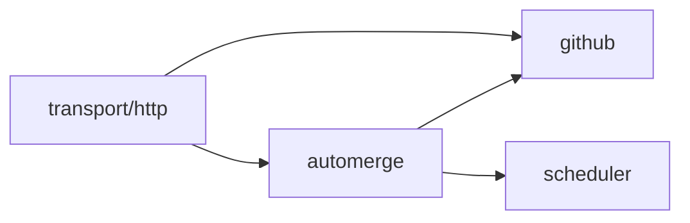

[](https://circleci.com/gh/alexfalkowski/abgleich)
[](https://codecov.io/gh/alexfalkowski/abgleich)
[](https://pkg.go.dev/github.com/alexfalkowski/abgleich)
[](https://masterminds.github.io/stability/active.html)

# 🔄 Abgleich

Abgleich is a background worker that enables auto-merge or merges ready
Dependabot and labeled pull requests, and keeps auto-merge branches current
across a GitHub account's opted-in repositories.

## 🎯 Background

An open, non-draft pull request is stale when its branch is missing commits from
its base branch. Age does not affect eligibility. Only pull requests with
auto-merge enabled and both branches in the same discovered repository are rebased.
Public and private repositories accessible to the App installation are discovered on
each run. Archived, disabled, foreign, and repositories without **Allow auto-merge**
enabled are skipped entirely. That repository setting is the opt-in for the worker.

For Dependabot PRs, the worker also enables squash auto-merge while requirements
are pending, or requests a squash merge when GitHub reports the PR ready. It
identifies Dependabot by the PR author `dependabot[bot]`, independent of branch
names. This automatic Dependabot policy excludes draft, closed, and fork PRs.
Other authors can enable auto-merge themselves or opt in with a label.

### 🏷️ Labeled pull requests

Apply the exact label `automerge` to an open, non-draft PR to request squash
auto-merge. If GitHub reports the PR ready, the worker requests a guarded squash
merge immediately. The repository must allow auto-merge and squash merging.

This policy supports PRs from forks as well as branches in the repository. The
base must belong to the discovered repository. The worker never rebases fork
branches; their authors keep them current. Labeled branches in the same
repository can be rebased on a later sweep once auto-merge is enabled.

Label permissions in the target repository control who can opt a PR in. Forking
or opening a PR grants no labeling permission. Authorized bots and workflows can
also apply labels, so configure them accordingly. The label requests automation
for the PR; it is not an approval tied to a particular commit. Configure GitHub's
required reviews and stale-review rules when changes need human approval.

If GitHub disables auto-merge, including after an external contributor pushes,
the existing label cannot restore it. Remove and reapply `automerge` to renew the
request. Wait at least a second between removing and reapplying the label so
the event timestamps are unambiguous. The worker reads complete label and
disable-event history on each run, including after restart. Missing or invalid
history prevents automation; equal application and revocation timestamps defer it.

Removing the label prevents a new request; it does not cancel auto-merge already
enabled on GitHub. To stop that merge, disable auto-merge in GitHub as well.

### 💬 Comment requests

With GitHub App authentication and webhooks configured, post a new PR comment
containing exactly `@abgleich automerge`. Surrounding whitespace is allowed.
The worker checks the author's current write or admin permissions, re-reads the
comment and PR, and adds `automerge`. The App reacts on the original command:

| Reaction | Meaning |
| --- | --- |
| 👀 | The signed command was received and processing started. |
| 👍 | The request was accepted: the label was added or automation was already enabled or labeled. |
| 😕 | The request was ineligible, rejected, or failed. |

Acceptance confirms command processing; the PR's status shows when merging finishes.
The label remains the durable request for automation;
the next scheduled sweep applies the existing merge policy. Fork PRs are supported.
Edited comments and bot authors do not authorize requests.

An existing label or enabled auto-merge needs no label write. The App still checks
the current comment and the author's permission before acknowledging acceptance.
A delivery whose original comment is at or before a label removal or auto-merge disablement
cannot add the label. Missing history prevents action. After a revocation, remove
any remaining label and post a new command with a later timestamp to renew the
request. These checks survive restarts without local storage. GitHub label writes
do not support an expected-state guard: a simultaneous manual change can still
race the final write. This is not an exactly-once delivery guarantee.

Reactions are best effort and do not control automation. Each reaction gets at
most one second and a quarter of the remaining delivery budget, so slow feedback
leaves time for the label operation. An outage or exhausted deadline can leave
feedback incomplete; reaction failures are logged. Reactions remain on the
comment, and GitHub reuses an existing reaction on redelivery. A later attempt
can therefore leave both rejection and acceptance reactions; consult the label
and current PR state for the outcome.

## 🚀 Quickstart

Run these steps from the repository root.

### ✅ Prerequisites

- Go matching [go.mod](go.mod).
- Git with GitHub SSH access for the `bin/` submodule.
- Ruby with Bundler for dependency setup and the Cucumber harness.
- Make, plus `curl` for the readiness check below.

### 🏗️ Bootstrap and build

Initialize the shared tooling, install dependencies, and build the worker:

```sh
git submodule sync
git submodule update --init
make dep
make build
```

### ▶️ Configure and start

Save the example in **Configuration** below as `config.yaml`. Set the owner,
App ID, installation ID, and path to the App's RSA private key. The key uses a
go-service source such as `file:/etc/secrets/abgleich/github-app-private-key.pem`
and is read once at startup. App registration and permissions are described
under **GitHub App setup**.

Start the worker:

```sh
./abgleich server -config file:config.yaml
```

The worker begins checking the account's repositories immediately. Leave it
running, and use another terminal to verify readiness:

```sh
curl --fail --silent --show-error http://localhost:11000/abgleich/readyz
```

An HTTP 200 response with body `SERVING` confirms process readiness. Check the
worker's structured logs for GitHub check outcomes; readiness is independent of
whether a branch check succeeds.

## 🚀 Server

The worker runs immediately on startup and, by default, every fifteen minutes
thereafter. It discovers all owned repositories before processing them serially.
For each repository, it lists open pull requests through go-github, compares each eligible
branch with its base, and asks GitHub to rebase stale branches using the GraphQL
[`updatePullRequestBranch`](https://docs.github.com/en/graphql/reference/pulls#updatepullrequestbranch)
mutation with `updateMethod: REBASE`. This is the server-side operation used by
GitHub's update-with-rebase UI and CLI. GitHub performs the branch update.

Before listing PRs, the worker reads the full repository settings; GitHub's
repository list omits merge settings. Dependabot and labeled automation use GraphQL
[`enablePullRequestAutoMerge`](https://docs.github.com/en/graphql/reference/pulls#enablepullrequestautomerge)
with `mergeMethod: SQUASH` and `expectedHeadOid`, or the REST merge API with
`merge_method: squash` and the expected head SHA. Immediate merges require `mergeable: true` and
`mergeable_state: clean`; unknown or failing check states never trigger an
immediate merge. GitHub still enforces checks, reviews, and repository rules.
The worker does not approve reviews or request rule bypasses.

Each sweep attempts at most one mutation per PR. After enabling auto-merge,
a later sweep can rebase a stale branch. If squash merging is disabled, the
merge action fails with an operator-visible error instead of choosing
another merge method. Other authors' auto-merge PRs retain their selected method.

Pull requests are rechecked immediately before each mutation. Rebases and
auto-merge enablement include `expectedHeadOid`, and immediate merges include `sha`, so concurrent branch changes
reject those requests and are discovered on the next run. Conflicts reported by GitHub fail the branch and
require an author to repair it. One failed branch does not prevent other
eligible branches or repositories from being processed. After a timeout, the
next scheduled sweep starts with fresh repository discovery.

Discovery validates that the App installation belongs to `github.owner`.
All repository pages must succeed before processing begins. Pull request pagination
also finishes before any branches in that repository are updated.

The process needs network access to the GitHub REST and GraphQL APIs. It does
not clone repositories, execute Git, or need a writable checkout directory.

## ⚙️ Configuration

The `github` and `health` blocks are required. Both `health.duration` and
`health.timeout` must be positive durations; they have no defaults. This example
also includes shared go-service settings for identifiers, logging, metrics, and
the HTTP listener.

Save it as `config.yaml` and adjust `github.owner`:

```yaml
environment: production
github:
  client:
    timeout: 1m
    retry:
      attempts: 2
      backoff: 100ms
  owner: alexfalkowski
  app:
    id: 5427450
    installation_id: 174152088
    private_key: file:/etc/secrets/abgleich/github-app-private-key.pem
scheduler:
  interval: 15m
  timeout: 5m
health:
  duration: 1s
  timeout: 1s
id:
  kind: uuid
telemetry:
  logger:
    kind: json
    level: info
  metrics:
    kind: prometheus
transport:
  http:
    address: tcp://:11000
    timeout: 5s
    max_receive_size: 1048576B
```

Set `github.owner` and `github.app` for all GitHub access. Add
`github.webhook` for comment commands. The schedule and HTTP client settings
are optional:

| Setting | Default | Purpose |
| --- | --- | --- |
| `scheduler.interval` | `15m` | Time between owner-wide sweeps. |
| `scheduler.timeout` | `5m` | Deadline for a complete owner-wide sweep. |
| `github.client.timeout` | `1m` | Deadline for an individual HTTP request. |
| `github.url` | `https://api.github.com/` | REST API origin; GraphQL uses `/graphql` on the same origin. |
| `github.webhook.timeout` | `5s` | Complete synchronous delivery budget; must be positive and below `10s`. |
| `transport.http.max_receive_size` | `4MB` | Incoming request body limit for all HTTP routes; the example sets 1 MiB. |

Omitted or zero scheduler durations and GitHub client timeouts use the defaults
above. Negative schedule durations are invalid.

### 🔌 HTTP transport

GitHub HTTP transport settings live under `github.client`: timeout, retries,
circuit breaking, and TLS. Retries and circuit breaking remain disabled unless configured.
Configured retries apply only to safe HTTP methods. Rebase, auto-merge, and merge
mutations are never retried by the HTTP transport; a later scheduled run reads
current GitHub state before deciding whether another action is needed.

### 🚦 API usage

The shared go-github client processes repositories and pull requests serially.
The fifteen-minute interval limits polling volume; there is no additional rate-limit
library or configuration. If GitHub reports throttling, the current sweep stops
instead of continuing through other repositories. go-github retains its built-in
rate-limit checks, and a later scheduled run reads current state again.

Polling and comment commands share the installation's API budget. Monitor repeated
rate-limit failures and increase `scheduler.interval` if needed.

### 🔐 Credentials

The worker and comment handler share one App installation. Configure
`github.app.id`, `github.app.installation_id`, and `github.app.private_key`;
`github.owner` must match the installation's account. A personal access token
is not used. `ghinstallation` signs App requests and caches and renews the
installation access token. REST and GraphQL use the same installation credentials;
App clients reject redirects to another API origin.

The worker validates the installation's App ID, owner, and suspension state once
per sweep and once per comment command, before repository access. It discovers
only repositories granted to that installation, including private repositories.
Install the App on all owned repositories to include new repositories
automatically, or select repositories explicitly.
Enable **Allow auto-merge** on each repository to opt in, and **Allow squash
merging** for Dependabot and labeled automation. Required reviews and checks still
apply; give the App no ruleset bypass.

### 🤖 GitHub App setup

Register the App with **Contents: read and write**, **Pull requests: read and
write**, and **Issues: read and write**. Metadata read access is automatic. The worker
uses server-side rebases and squash merges; the comment handler adds the existing
`automerge` label and reactions. Issues write access is required for comment
reactions. When upgrading an existing App, update its permissions and approve
the installation's permission change. Use your own App and installation IDs in
the configuration.

Omit `github.webhook` to run the worker without exposing a webhook endpoint.
To receive comments, add this block to the existing `github` configuration:

```yaml
github:
  webhook:
    secret: file:/etc/secrets/abgleich/github-webhook-secret
    timeout: 4s
```

The webhook secret uses go-service sources such as `file:` or `env:`. Keep HTTP
request, webhook, job, and health timeouts independent; the server HTTP timeout
must accommodate the webhook budget. The explicit `4s` budget leaves response
time within the example's `5s` HTTP timeout.

To enable comment commands, configure the App's **Issue comment** subscription,
a random webhook secret matching `github.webhook.secret`, and an HTTPS webhook
URL ending in `/webhooks/github`. The proposed deployment URL is
`https://abgleich.lean-thoughts.com/webhooks/github`; DNS and ingress must be
provisioned before activation. The handler requires SHA-256 signatures. The shared
HTTP transport enforces `transport.http.max_receive_size`; set `1048576B` for a
1 MiB limit as shown above. It acknowledges ignored and completed deliveries with
HTTP 204, rejects invalid signatures with 401 and unauthorized commands with 403,
and returns non-success for API failures, conflicts, or processing timeouts.

Processing stays inside the request; no background queue or delivery cache is
used. Each process runs one command at a time, with concurrent commands receiving 503.
GitHub does not automatically redeliver failed webhooks. Inspect delivery results
in the App settings and redeliver failures after recovery. Ambiguous label
responses are not retried automatically; redelivery re-reads current state.
Polling continues when webhook delivery is unavailable. App API failures can
prevent both polling and comment operations; they do not affect process health.
Installation requests share a cancellable request slot so a webhook deadline
also bounds waiting for another request or token renewal.

For rollout, replace `github.token` in runtime configuration with the `github.app`
block above. The existing deployed secret can retain its old token entry while
the new version is deployed; remove that unused entry after a successful rollout.

> [!IMPORTANT]
> App private keys and webhook secrets are read once at startup.
> Missing or empty configured sources and invalid RSA PEM files prevent startup.
> Restart the worker after changing these sources. Installation access tokens
> renew automatically. GitHub authentication failures occur during requests and
> do not make worker health fail.

## 🩺 Health

The service exposes HTTP observability endpoints:

| Endpoint | Behavior |
| --- | --- |
| `/abgleich/healthz` | Shared external connectivity check. |
| `/abgleich/readyz` | Process readiness, independent of scheduled job outcomes. |
| `/abgleich/livez` | Process liveness, independent of GitHub failures. |
| `/abgleich/metrics` | Prometheus metrics when that exporter is configured. |

Job failures, conflicts, and timeouts do not affect these health checks. Infraops
probes the private readiness and liveness endpoints directly, including for
workers without a Service or Ingress.

`health.duration` controls how frequently health state is sampled.
`health.timeout` bounds the shared connectivity check; it is independent of the
scheduled job's run timeout.

## 📊 Telemetry

Each completed run produces one log entry with `job`, `duration`, `interval`, and
`overrun`. The auto-merge job uses `job: automerge`.

| Outcome | Log level | Details |
| --- | --- | --- |
| Success | `info` | The check completed within its interval. |
| Successful overrun | `warn` | The check succeeded but exceeded its interval. |
| Failure | `error` | Includes the error, even when the check also overran. |

Accepted rebase requests, enabled auto-merges, and confirmed merges identify the
repository, pull request, and branch. Their messages are `requested pull request rebase`,
`enabled pull request auto-merge`, and `merged pull request`, respectively. Failures
include repository names and pull request numbers where available. GraphQL errors
are failures even when the HTTP response is 200. A failed branch contributes to
the run's failure outcome while other eligible branches continue to be processed.

- **Timeouts:** the default run timeout cancels active work after five minutes.
- **Overruns:** work that exceeds its interval sets `overrun` to `true` when it
  finishes, preserving the handler's success or failure result.
- **Overlap:** each tick attempts to start work. Attempts while the previous run
  is active are ignored; missed attempts are not queued.

Scheduled job monitoring uses structured logs. Configure collection and alerts
for repeated failures, exceeded intervals, and missing completed runs in your log
backend. The scheduler does not publish custom job metrics. Standard go-service
HTTP and runtime telemetry remains available through its configured exporters.

## 📦 Deployment

- **Instances:** run as a long-lived service with one active instance. Scheduling
  limits apply within a process; the expected head OID guards updates from other instances and CI.
- **Restarts:** use liveness for restart decisions so a GitHub outage does not cause restart loops.
- **Shutdown:** active work is cancelled, and the worker waits for it to stop.

### 🧯 Recovery

No local checkpoint or database is needed. Every run reconciles current GitHub
state. After a crash, timeout, or ambiguous mutation response, a fresh run
determines whether the remote branch still needs updating. GitHub can complete
an accepted update after the caller stops waiting; retries always compare current
remote state before requesting another rebase. The standard service container
image is sufficient.

## 🧩 Design

| Package | Responsibility |
| --- | --- |
| [`automerge`](internal/automerge/reconciler.go) | Repository opt-in, strategy selection and ordering, comment command policy, and job registration. |
| [`automerge/internal/strategy`](internal/automerge/internal/strategy/doc.go) | Dependabot, label, and rebase policies with fresh pre-mutation checks. |
| [`github`](internal/github/service.go) | Owner-wide repository discovery, identity checks, authenticated API access, pagination, and response validation. |
| [`scheduler`](internal/scheduler/scheduler.go) | Independent schedules, timeouts, overlap protection, outcome logs, and job lifecycle. |
| [`transport/http`](internal/transport/http/doc.go) | Webhook route registration, request deadlines, and HTTP responses. |
| [`cmd`](internal/cmd/module.go) | Composition of package modules. |

Dependencies follow the responsibilities:



`automerge.Reconciler.Reconcile` asks `github.Service` for all repositories, then uses
that service for repository settings, PR reads, identity checks, comparisons,
auto-merge enablement, and guarded rebase and merge requests. `github.Repository`
and pull request types alias SDK snapshots;
they contain no service behavior. The service uses an injected `github.Client`,
which holds the installation SDK client and a private JWT client for installation
identity checks. The GitHub module constructs it once through `github.NewClient`.
The reconciler, strategies, and `Commands` receive the same `github.Service`.
`transport/http` verifies deliveries through `github.Webhook`, then calls
`automerge.Commands.Handle` for command recognition and authorization. The
transport owns HTTP responses and delivery deadlines; go-service enforces the
configured body limit. `cmd.Module` composes the transport with the domain modules.
Shared HTTP options and connection cleanup are provided through
`github.NewConnection`.
SDK imports stay inside `internal/github`.

The strategy module provides the policies in this order: Dependabot, label,
rebase. The reconciler receives the ordered slice through DI and selects the first match.
A selected strategy owns the PR for that sweep, including no-op and error
outcomes. The strategy interface, implementations, and shared PR
eligibility helpers live in `internal/automerge/internal/strategy`.
Each strategy owns its applicability and fresh pre-mutation checks.
Label authorization uses paginated GraphQL history; GitHub field aliases
decode events into SDK issue-event snapshots. The GitHub package owns snapshot
completeness checks, exact label lookup, and extraction of the latest event
timestamps. Automerge applies its authorization and revocation rules to those facts.

Logging is composed around operations. `github.NewService` wraps the API service
with a logging decorator to report accepted actions after response validation.
`Scheduler.Register` wraps each handler to report its outcome and overruns
within the job's timeout.

### 🗓️ Job registration

Each package registers construction in its own module. The
[auto-merge module](internal/automerge/module.go) constructs the reconciler and
registers `Reconcile` as the `automerge` job. Other feature packages can register
their own named handlers and schedules through `Scheduler.Register`. Registration
finishes before startup, and duplicate names prevent application startup.
Scheduler has no feature-package dependencies.

The [scheduler module](internal/scheduler/module.go) connects `Scheduler.Start`
and `Scheduler.Stop` to the service lifecycle. Each
[job](internal/scheduler/job.go) has its own ticker, run timeout, cancellation,
and outcome logs. Jobs run independently and use a nonblocking lock to admit
one run per job at a time. Shutdown cancels all jobs before waiting for active
work. Handlers must observe cancellation and return their complete outcome.
Health checks are independent of the scheduler.

GitHub API access uses [go-github v93](https://github.com/google/go-github/releases/tag/v93.0.0).

## 🛠️ Development

If you would like to contribute, here is how you can get started.

### 🗂️ Structure

The project follows the structure in [golang-standards/project-layout](https://github.com/golang-standards/project-layout).

### ✍️ Style

This project favours the [Uber Go Style Guide](https://github.com/uber-go/guide/blob/master/style.md)

### 🏁 Setup

After completing the quickstart's bootstrap steps, run the auto-merge features:

```sh
make features feature=features/automerge
```

Use `make help` to discover the other development commands.

Run a CI feature group locally with `make features-merges`,
`make features-commands`, or `make features-worker`. These select `@merges`,
`@commands`, and all remaining features, respectively. New features belong to
the worker group unless tagged for one of the other groups. Run groups one at
a time locally because the harness shares ports and configuration files.

Nonnative starts the worker and a local fake GitHub REST and GraphQL API:

- [Rebasing](test/features/automerge/rebase.feature) covers eligibility,
  pagination, conflicts, and concurrent changes.
- [Dependabot](test/features/automerge/dependabot.feature) covers repository opt-in,
  enabling auto-merge, guarded squash merges, exclusions, and failure recovery.
- [Labels](test/features/automerge/label.feature) covers labeled fork and repository
  PRs, authorization renewal, complete history, and concurrent changes.
- [Repositories](test/features/automerge/repositories.feature) covers owner-wide
  discovery, private repositories, failure isolation, throttling, and timeout recovery.
- [Recovery](test/features/automerge/recovery.feature) covers GitHub failures,
  retries, and ambiguous mutation responses.
- [Scheduling](test/features/automerge/schedule.feature) covers timeouts,
  overlap prevention, and restart recovery.
- [Credentials](test/features/config/config.feature) covers startup token
  validation and replacement. Run it with `make features feature=features/config/config.feature`.

Failure scenarios also verify that process probes remain healthy. Tests use an
accelerated schedule and disposable credentials; they do not modify GitHub.
See [CI](.circleci/config.yml) for the build and release workflow.

### 📝 Changes

Release history is available in [GitHub releases](https://github.com/alexfalkowski/abgleich/releases).
