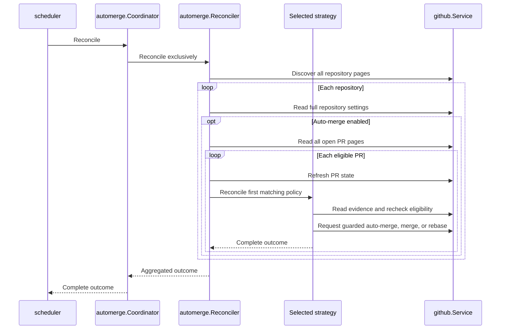
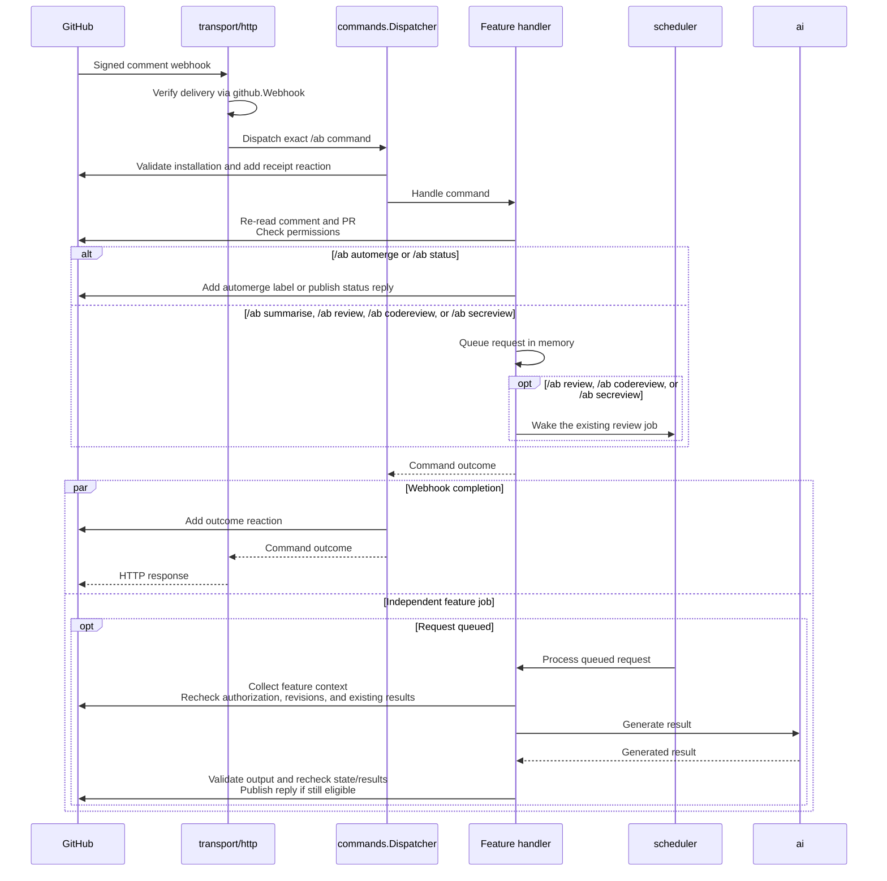

# 🧩 Design

[← Back to README](../README.md)

Feature packages own policy; [`github`](../internal/github/doc.go) owns discovery,
remote access, and response validation. [`cmd`](../internal/cmd/module.go) composes
modules. Package docs describe [cleanup](../internal/cleanup/doc.go),
[status](../internal/status/doc.go), [summaries](../internal/summarise/doc.go),
[code reviews](../internal/review/code/doc.go), and
[security reviews](../internal/review/sec/doc.go).

[`review`](../internal/review/doc.go) composes the code and security feature modules
and their configuration, and registers `/ab review`. Every enabled command
constructed through `workflow.Factory` joins aggregate requests automatically.
The aggregate preserves the original comment for consent rechecks and uses
each feature's existing queue and result identity. Each feature configures a separate instance of the shared
[`workflow`](../internal/review/internal/workflow/doc.go), which owns PR eligibility,
patch and related-source collection, revision checks, deduplication, inference,
safe publication, and the common reply template.
[`sources`](../internal/review/internal/sources/doc.go) selects registered providers
from reviewed paths. Go and Ruby providers own their guides, source tools,
manifest parsing, verification, HTTP policy, and per-review caches. Workflow
provides pinned repository reads and wraps every tool with consent/revision checks.
`sources.Module` composes provider modules, which contribute strategies through a
DI value group. The registry collects that group without constructing individual
providers; workflow uses their shared contract. Feature packages retain prompts,
model settings, schedules, and registration. Reviews, summaries, status, and automerge use `commands.Authorizer`
to re-read human commands and current permissions at their own consent boundaries;
PR eligibility and automation history remain with their owning feature.

## 🔄 Auto-merge sweep

The diagram shows an eligible action; policies can also return no-op or error.

[Strategies](../internal/automerge/internal/strategy/doc.go) run in
**Dependabot → label → rebase** order; the first match owns the PR, including
no-op and error outcomes. [`automerge`](../internal/automerge/doc.go) also provides
read-only assessments for status. See [Server](automation.md#-server) for mutation safeguards.

Repository webhooks queue work in `automerge.Coordinator`. The coordinator
resolves the notified name through complete installation discovery, then
reconciles only that repository. It finishes active work before starting another
sweep or event check. See [event-triggered checks](automation.md#-event-triggered-checks) for
queue behavior.

## 💬 Comment commands

Accepted commands share `github.Service`; summary and review processing run independently.

[`transport/http`](../internal/transport/http/doc.go) verifies webhooks;
[`commands`](../internal/commands/doc.go) dispatches to feature handlers and provides
shared human-command authorization; review handlers use the workflow above. SDK imports stay
inside `github` and [`ai`](../internal/ai/doc.go),
using shared [client construction](../internal/transport/http/client/doc.go).

## 🗓️ Job registration

Features register unique names through `Scheduler.Register` and
`commands.Dispatcher.Register` before startup; duplicates prevent startup.
The feature-independent [`scheduler`](../internal/scheduler/doc.go) runs each job
immediately, then on its own interval and deadline. Handlers observe cancellation
and return complete outcomes. Manual review requests also wake their existing job;
these runs share its timeout and overlap protection and leave thread maintenance
to scheduled runs. See [Operations](operations.md#-operations) for lifecycle and logs.
