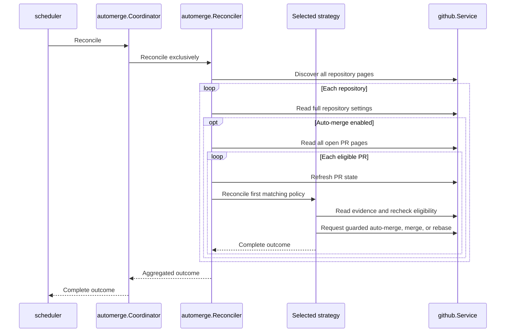
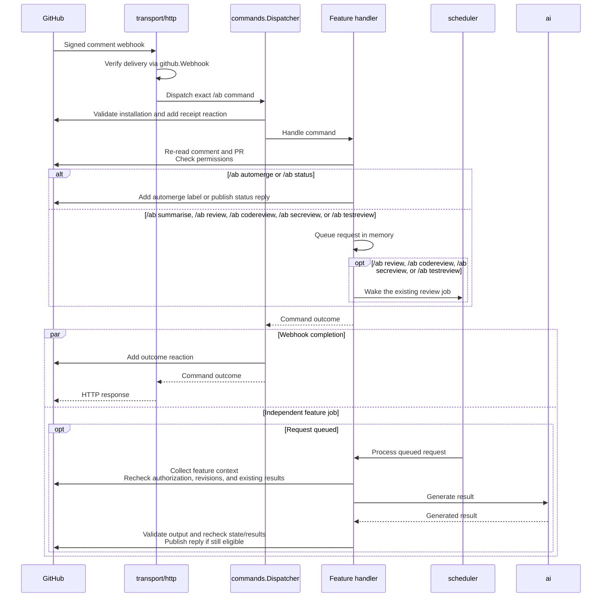

# 🧩 Design

[← Back to README](../README.md)

Feature packages own policy; [`github`](../internal/github/doc.go) owns discovery,
remote access, and response validation. [`cmd`](../internal/cmd/module.go) composes
modules. Package docs describe [cleanup](../internal/cleanup/doc.go),
[status](../internal/status/doc.go), [summaries](../internal/summarise/doc.go),
[code reviews](../internal/review/code/doc.go),
[security reviews](../internal/review/sec/doc.go), and
[test reviews](../internal/review/test/doc.go).

[`review`](../internal/review/doc.go) composes the code, security, and test feature modules
and their configuration, and registers `/ab review`. Every enabled command
constructed through `workflow.Factory` joins aggregate requests automatically.
The aggregate checks consent and PR eligibility once on delivery and passes the
original comment to each feature's independent queue. Feature packages own their
prompts, models, schedules, and registration.

[`workflow`](../internal/review/internal/workflow/doc.go) coordinates review
admission, source collection, inference, and publication. It rechecks consent
and revisions at each boundary and serializes final checks and publication
across features.

- [`sources`](../internal/review/internal/sources/doc.go) reads repository and
  submodule files at pinned revisions. A session records inspected source and
  omissions and applies the workflow's guard to every model-requested lookup.
  Providers contribute through a DI value group. Each owns its guides, tools,
  manifest parsing, verification, HTTP policy, and per-review lookup caches as
  applicable.
- [`history`](../internal/review/internal/history/doc.go) interprets authenticated
  App reviews. It owns result markers and follow-up records, detects duplicate
  results, and checks whether another feature's verdict still blocks approval.
- [`assessment`](../internal/review/internal/assessment/doc.go) validates model
  output, reconciles findings against earlier evidence, and prepares the
  verdict and safely rendered native review. Workflow applies the latest
  cross-feature approval check before submission.
- [`threads`](../internal/review/internal/threads/doc.go) reconciles outdated
  threads within the feature's scheduled run after the manual queue drains.

Reviews, summaries, status, and automerge use `commands.Authorizer` to re-read
human commands and current permissions. Each feature owns its eligibility
criteria and chooses when to recheck consent.

AI features embed `ai.ModelConfig` for provider, model, and effort selection.
`ai.Registry` constructs named connections and resolves each feature's selection
at startup. Provider adapters implement `ai.Provider` inside `ai`; adding an
adapter does not change review or summary processing. OpenAI uses its native SDK.
Each connection owns its credentials and HTTP client; features retain their
instructions, source authorization, and generation deadlines.

## 🔄 Auto-merge sweep

The diagram shows an eligible action; policies can also return no-op or error.

[Strategies](../internal/automerge/internal/strategy/doc.go) run in
**Dependabot → label → rebase** order; the first match owns the PR, including
no-op and error outcomes. [`automerge`](../internal/automerge/doc.go) also provides
read-only assessments for status. See [Server](automation.md#-server) for mutation safeguards.

Repository webhooks queue work in `automerge.Coordinator`. The coordinator
resolves the notified name through complete installation discovery, then
reconciles only that repository. It finishes active work before starting another
sweep or event check. See [event-triggered checks](automation.md#-event-triggered-checks) for
queue behavior.

## 💬 Comment commands

Accepted commands share `github.Service`; summary and review processing run independently.

[`transport/http`](../internal/transport/http/doc.go) verifies webhooks;
[`commands`](../internal/commands/doc.go) dispatches to feature handlers and provides
shared human-command authorization; review handlers use the workflow above. SDK imports stay
inside `github` and [`ai`](../internal/ai/doc.go). These packages and the review
source providers construct their own outbound connections from their
[HTTP client settings](configuration.md#-http-transport) using go-service.

## 🗓️ Job registration

Features register unique names through `Scheduler.Register` and
`commands.Dispatcher.Register` before startup; duplicates prevent startup.
The feature-independent [`scheduler`](../internal/scheduler/doc.go) runs each job
immediately, then on its own interval and deadline. Handlers observe cancellation
and return complete outcomes. Manual review requests also wake their existing job;
these runs share its timeout and overlap protection and leave thread maintenance
to scheduled runs. See [Operations](operations.md#-operations) for lifecycle and logs.
